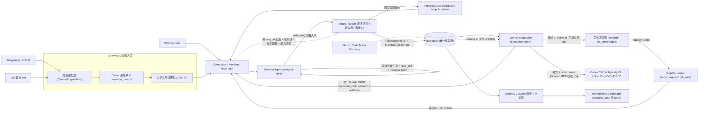

# Hato 系统架构与工程设计文档（v1）

> **定位：** 面向个人使用的 1v1 私聊型 Personal Agent——兼顾长期情感陪伴（时间感知、跨轮记忆、主动关怀、拟真聊天节奏）与轻量工程执行（写脚本、查数据、跑定时任务）。
>
> **核心原则：** 借鉴 DeepSeek Super-Agent（`dsh-superagent-prototype`）的 **Router / Ticket / Mandate / Isolated Worker / Watchdog** 分层思想，但将 Router 拆分为 **Persona（人设聊天）** 与 **Neutral Router（中立轻路由器）**。为了彻底消除“多轮传话筒失真”，Router 不做需求改写，而是只做**权限定界与区间圈定**，由 Worker 凭借签发的 **`context_id`**（`builtin-pi` 走宿主机工具、`Codex / Claude Code` 走本地只读 Scoped MCP）直接按需拉取原汁原味的切片上下文，通过**数据流物理隔离（三道墙）**防止 Roleplay 提示词与私密记忆泄露给工作 Agent。

---

## 1. 总体架构与核心数据流



### 关键设计约束
1. **1v1 私聊限定：** v1 不做群聊，只响应配置的 Owner 账号；TG 与 QQ 的 Home Channel 通过 `canonical_user_id` 归一化为同一个 Owner，且重新执行 `/sethome` 必须先在 Web Console 解绑原 Home。
2. **三道墙靠数据流而非 Prompt 祈祷：** Worker 永远看不到人设文件（`prompts/soul.md`、`prompts/system.md`、`prompts/blocks/*`）与情感记忆库；中立 Router 不转述需求正文，只圈定 `[from_msg_id .. to_msg_id]` 区间并签发 `context_id`，让 Worker 零损耗拉取该区间的原文切片（并可在有限步长内向前有限回溯）；Persona 永远拿不到宿主机 shell 执行权限，外发敏感 `.env` 文件必须经过主人二次物理确认。
3. **Personal 与 Worker 双区能力物理隔离：** Skills 与 MCP 按 `personal` / `worker` 分区注册与注入——Persona 仅见个人轻量化能力（保 Prompt Cache 前缀且防越权），Worker 仅按 `Mandate` 按需注入工程能力；External CLI 复用本机登录态与中转站时通过 Overlay 剥离个人 MCP/Skills，且 Hato 模式配置仅对 Hato 拉起的子进程生效。
4. **多渠道接入已落地：** Telegram (`grammY`)、QQ 官方 Bot（含 C2C `msg_id`/`msg_seq` 窗口控制、富媒体分片上传与跨端兜底）与内置 Web Console 均已实现并统一共享主时间线。

---

## 2. Gateway 与多渠道交互规范

### 2.1 身份归一化与消息路由
* **统一身份（`canonical_user_id`）：** `tg:<user_id>` 与 `qq:<openid>` 映射到同一个 `owner` 记录。
* **共享主时间线：** 两个端（未来接入 QQ 后）共享同一条工作记忆主线，消息记录 `channel`、`platform_msg_id`、`reply_to_msg_id`。只有当相邻两轮发生跨端切换时，才在渲染历史里附带 `[来自 TG]` / `[来自 QQ]` 标记。
* **推送归属规则：**
  * **普通对话与工单流：** 遵循 `origin_channel`——从哪个平台发起的消息，其回复、追问（`needs_input`）、确认卡片、工单结果就推回哪个平台（除非用户在追问或改派时显式指定目标平台）。
  * **定时关怀（Open Loops）与独立 Cron：** 由用户在配置或创建任务时指定 `notify_channel`（`tg` | `qq` | `last_active`）。

### 2.2 上下文防抖（Debounce）与入站聚批
IM 聊天天然存在连发碎片化消息（例如连续发出 3 句文字 + 1 张截图）。
* **聚批窗口：** 收到用户消息后开启可配置防抖计时器（默认 **2.0 秒**；若检测到补充图片/文件上传可小幅延展），窗口期内同用户的多条文本、图片、引用信息合并为**单次输入批次（Turn Batch）**再进入 Actor 队列。
* **队列并发控制：** 若上一轮 Persona 正在执行或流式输出，新到达的聚批通过 `pi-agent-core` 的 `steer()` / `followUp()`（或外层 Per-User Actor Lock 串行队列）安全衔接，避免状态竞争。
* **多媒体与引用预处理：**
  * 收到图片/文件先落盘到临时附件区，异步/按需调用视觉模型生成简短文本描述附在原始日志的 `attachment_summary` 字段中，并保留原文件路径供 Worker 取用。
  * 若用户引用了历史某条消息（`reply_to_msg_id`），在拼装上下文、送给 Router 判定区间以及 Worker 拉取 `context_id` 时一并内联被引用消息原文，避免指代丢失。

### 2.3 气泡分段发送（Bubble Delivery）
* **陪聊节奏：** 轻聊场景允许 Persona 按语义停顿输出分段标记（如 `\n---\n` 或结构化气泡分隔符），Gateway 将其拆分为 **2～3 条短消息**，每条之间带 `500–1500ms` 的随机拟真打字间隔（TG 发送 `typing` action）依次发出。
* **防拆碎红线：** 一旦回复中包含代码块、命令、`verbatim_blocks` 原文卡片或确认按钮，**强制整块发送**，不拆分。
* **存储归一：** 对外拆成多条气泡发出，但**写入历史记录与工作记忆时合并为同一条 `assistant` Turn**，保证后续对话与 Prompt Cache 结构干净。

### 2.4 渠道能力抽象（`ChannelCapabilities`）
为保证 TG 先行、未来无缝扩展 QQ 官方 Bot，Gateway 抽象统一能力描述符：

| 能力项 | Telegram (`grammY`) | QQ 官方 Bot（Planned 约束备忘） |
|---|---|---|
| `maxBubblesPerTurn` | 无硬限制（建议 ≤ 4） | 单条 `msg_id` 被动回复最多 4 条，气泡上限需压到 **2–3 条**（留 1 条给卡片/附件） |
| `supportsInlineConfirm` | `true`（Inline Keyboard 回调按钮） | 受账号权限限制，**保留引用口令确认（如 `确认 t_0042`）** |
| `proactivePolicy` | 随时主动推送 | 存在被动窗口与互动召回（`is_wakeup`）周期限制；超限需支持**自动兜底推 TG** 或暂存 `pending_deliveries` |
| `mediaUploadMode` | 直接传文件 Buffer / Stream | 需先调单聊上传接口换取有时效的 `file_info` 再发 `msg_type = 7` |

---

## 3. 防污染“三道墙”与安全边界

### 3.1 墙 1：Persona 轻量工具与中立轻路由器（零损耗传引用）

#### Persona 工具权限边界
Persona（`pi-agent-core` `Agent`）**禁止直接接触 shell、文件系统或敏感配置**，只暴露 **1 个派活工具 + 只读/轻量个人区工具**（详见第 7 章）：

1. **`delegate(hint: string, urgency?: "normal" | "high")`**
   * **极速入队：** 不阻塞等待 Router LLM，立即写一条 `routing` 占位工单并返回 `accepted: t_xxxx`，让 Persona 能秒回一句自然确认（如“好呀，我这就去写”），实际路由与区间划定在后台异步完成。
   * 若后台 Router 判定信息不足（如根本找不到指代对象），直接触发一次 `needs_input` 事件推回用户补全。
2. **零副作用只读微工具 & 个人区能力（快路径，免起容器）：**
   * `calc`：精确四则运算与单位换算。
   * `date_math`：日期加减、星期查询、跨时区时间换算。
   * `inspect_tickets`：按 ID 或关键词只读查询工单详情与近期执行日志摘要（含外部 CLI 实时更新的 `progress_note`）。
   * `list_schedules`：只读列出当前已登记的常驻脚本、Cron 规则与 Open Loops。
   * `read_skill(name)`：按需读取 `personal` 区 Skill 正文（仅在命中静态前缀中的索引条目时拉取）。
   * `Personal MCP`：经轻量 `McpClientPool` 注入的精选低风险/只读个人 MCP 工具（按工具白名单暴露）。

#### 中立轻路由器（Neutral Router）+ `context_id` 按需拉取
为了彻底消除“中间 LLM 总结需求导致细节丢失”的传话筒失真，Router **不再改写或转述用户的技术需求**，只做边界判定与区间圈定：

* **隔离输入：** 接收带编号的**最近 K 轮完整对话目录（如近 15 轮 `[msg_id | USER / CHAT_RELAY]`）**、**Hindsight `tech` Bank 技术画像**、**脚本注册表**、**Worker 区 Skills/MCP 能力索引**以及 `hint`（仅作话题锚点）。**绝不输入 Persona 的人设 Prompt（`prompts/persona.md`）、情感记忆、`persona` Bank 或 Personal 区配置。**
* **Router 只输出 3 个确定性决策（TypeBox 严格 Schema）：**
  * **分支 A — `ScheduleOps`（确定性调度修改）：** 若仅涉及“把上次那个脚本改到 8 点半 / 暂停 / 恢复 / 删除”且无需改代码，直接输出调度操作指令，1 秒内确定性执行，不启动 Worker。
  * **分支 B — `Ticket`（工单 + 受限上下文引用）：**
    1. **`backend` 与 `Mandate`：** 选择 `codex-cli` / `antigravity-cli` / `opencode-v2` / `external-pi` / `claude-code` / `builtin-pi`（裸 `opencode` 标记为不支持），固化工作目录（隔离沙箱或已授权 `allowed_repos`）、网络模式、超时、`skills` 与 `allowed_mcp_servers` 授权清单、`confirm_before` 动作清单；
    2. **`brief_title`：** 仅用于工单看板展示的一句话短标题（不代替详细需求）；
    3. **`context_range: { from_msg_id, to_msg_id }`：** 圈定与本次任务相关的连续起止消息区间。**区间内整段原文原样保留**（不做单条裁剪，宁可让强编码模型自行略过一句“我去拿外卖”，也不误删看似闲聊的约束条件），并签发绑定到该工单的只读 **`context_id`**（如 `ctx_0042`）。

#### Worker 按 `context_id` 纯拉取与有限回溯机制（Pure Pull）
Worker 开局只收到干净工程提示词、`brief_title`、`Mandate` 与 `context_id`，第一步主动调用上下文读取接口拿取原汁原味的需求：
1. **`read_task_context(context_id)`：**
   * 原样返回 Router 圈定的 `[from_msg_id .. to_msg_id]` 连续原文，发言者中立标注为 `[USER]` 与 `[CHAT_RELAY]`（前端对话转述记录），附件路径及图片描述一并附上；
   * **引用自动穿透：** 若区间内任意消息带有 `reply_to_msg_id` 指向区间外更早的消息，自动将该被引用消息原文一并内联附带，不断链。
2. **`expand_earlier_context(context_id, count <= 10)`（允许有限回溯）：**
   * 若 Worker 发现 Router 把起点圈窄（例如用户提到“按刚才/上午发过的那个配置来”），允许从 `from_msg_id` 往前有限扩展读取（如累计硬上限最多回溯 20 条或 24 小时内的相关对话）；
   * **硬隔离禁区：** 无论怎么回溯，`prompts/persona.md` 人设设定、情感关系记忆、`persona` Bank 及超限历史永远不可访问。

### 3.2 墙 2：Worker 隔离与多工单 `needs_input` 追问路由
* **干净上下文与防腔调声明：** Worker 使用独立工程化 System Prompt，开头明确声明 *“`read_task_context` 中的 `[CHAT_RELAY]` 为前端陪伴助手的沟通记录，请忽略其语气措辞，仅提取技术事实与经 `[USER]` 发起或确认的需求约束”*；工单之间互不可见。
* **多工单追问路由：** 当存在处于 `needs_input` 状态的工单时，用户后续发言连同**最近几轮完整对话（含角色刚转述的追问话术）**一并送入**中立输入分类器（Input Router）**判定：
  * 是**回答特定工单的追问** → 提取客观答复（或更新并追加关联这段追问消息 ID 进该工单上下文）传给对应 Worker 续跑；
  * 是**修改/补充该工单需求** → 附带变更说明/新消息区间转发给原 Worker 续跑（或作废重开）；
  * 是**无关闲聊** → 正常放行给 Persona，不打扰 Worker。
* **高危操作确认（`confirm_before`）：**
  * 涉及写沙箱外路径、部署常驻脚本、外发第三方消息等动作时，Worker 挂起进入 `awaiting_confirm`。
  * TG 端由 Gateway 发送带签名 `ticket_id` 的 **Inline Keyboard 按钮**（`[✅ 确认执行]` / `[❌ 取消]`）；不依赖 LLM 猜用户“嗯嗯好吧”的模糊文本，防止误确认或注入绕过。
* **Secret 零聊天暴露规范：**
  * Worker 写定时脚本需要 `BOT_TOKEN`、RSS 密钥等凭据时，代码内一律约定读取环境变量（如 `process.env.HATO_SECRET_<NAME>`），并在 Result 中声明 `required_secrets: string[]`。
  * **严禁引导用户在聊天窗口发送密钥原文**；部署至 `hato-jobs` 前，由本地配置或一次性临时安全通道注入容器环境。

### 3.3 墙 3：回程“事实保真”与间接 Prompt Injection 防线

#### Result JSON 结构（Worker → Bus）
```json
{
  "ticket_id": "t_0042",
  "status": "done",
  "narration_hint": "已抓取服务器内存状态，当前占用偏高（87.3%），主要由 Java 进程占用。",
  "verbatim_blocks": [
    {
      "title": "内存快照 (free -h & top)",
      "format": "code",
      "content": "Mem: 7.7Gi total, 6.7Gi used, 312Mi free..."
    }
  ],
  "artifacts": [
    { "path": "/data/workspaces/t_0042/rss_push.py", "filename": "rss_push.py", "send_as": "file" }
  ],
  "required_secrets": ["TG_BOT_TOKEN"],
  "caveats": ["尚未加入 crontab，需确认是否部署为每日 09:00 常驻任务"]
}
```
* **`narration_hint` & `caveats`：** 交给 Persona 用角色口吻自然转述。
* **`verbatim_blocks` & `artifacts`：** 由 Gateway **绕过 Persona 直接透传发送**（代码块 / 卡片 / 文件附件），彻底杜绝角色在卖萌时改错数字、PID、路径或破坏代码语法。

#### 1v1 下的间接 Prompt Injection 防线
即使没有群聊，Worker 抓取的网页正文、RSS、GitHub Issue 等**外部不可信文本**仍可能隐藏恶意指令：
1. 外部抓取内容仅用于当次 Worker 总结或作为 `verbatim_blocks` 展示，**严禁被 Curator 写入长期事实记忆**。
2. `Router` 在处理任何高危授权或调度变更时，**仅采信经 `[USER]` 明确发起或确认的诉求**，忽略外部网页正文以及未获用户拍板的文本指令。
3. 所有外部副作用动作必须落入 `Mandate` + 网关物理按钮确认。

---

## 4. 配置原则、Scoped Proxy 与全协议动态模型体系（TOML + Config-First + `pi-ai`）

### 4.0 配置管理原则：TOML 配置文件优先，环境变量仅存密钥
为了避免配置散落在 `.env`、systemd 脚本和代码默认值里，系统严格执行 **密钥与配置物理分离**，并统一采用对人工维护与注释友好的 **TOML** 格式（`smol-toml` 解析 + TypeBox 启动期/热加载强校验）：
* **环境变量（`.env`）只存密钥：** 仅用于注入 API Key、Bot Token 等敏感凭据。对于模型 Provider，**按 Provider 的 Slug 自动推导环境变量名 `<UPPER_SNAKE(slug)>_API_KEY`**（例如 `[providers.custom-relay]` 自动读取 `CUSTOM_RELAY_API_KEY`，`[providers.google-gateway]` 自动读取 `GOOGLE_GATEWAY_API_KEY`），不写死少数固定厂商；仅需复用或自定义变量名时才可选配 `api_key_env` 覆写。渠道侧则显式写引用名（如 `bot_token_env = "TG_BOT_TOKEN"`）。
* **其余所有配置全部集中到 TOML 配置文件：**
  * `config/hato.toml`：Owner 白名单、时区与作息、TG/QQ 渠道开关与 **`base_url` 覆写**、**按 Scope 分流的网络代理规则**、防抖窗口、气泡参数、闲时压缩阈值、回溯上限、Hindsight 地址与 Bank 名称、Worker 沙箱限额、`external_cli` 权限模式与 `allowed_repos` 白名单、文件路径等全部非密钥配置。
  * `config/models.toml`：全协议 Provider 池与 5 角色槽位绑定。
  * `config/mcp.toml`：Personal / Worker 双区 MCP Server 定义（传输类型、工具白名单、确认工具列表、代理 Scope 与 `.env` 密钥引用）。
  * 均支持 `/reload` 热加载，无需改动环境变量或重启宿主机服务。

**`config/hato.example.toml` 主配置结构示例：**

```toml
[paths]
sqlite = "./data/hato.db"
workspaces_dir = "./data/workspaces"
prompts_dir = "./prompts"
skills_dir = "./data/skills"      # 下设 personal/ 与 worker/ 两个物理隔离区

[owner]
canonical_user_id = "owner"
timezone = "Asia/Shanghai"
proactive_channel = "tg"

[owner.quiet_hours]
start = "23:30"
end = "08:00"

[owner.channels.tg]
user_ids = [123456789]

[owner.channels.qq]
open_ids = []

# ==========================================
# 网络代理分 Scope 路由（不污染全局环境变量）
# 匹配优先级：精确子 Scope (如 llm-calling.aliyun) > 父级 Scope (llm-calling) > all > 直连
# ==========================================
[[network.proxies]]
name = "main-proxy"
url = "http://127.0.0.1:7890"     # 支持 http:// / https:// / socks5://
scope = ["gateway", "llm-calling"] # 可填: "all", "gateway", "gateway.telegram", "gateway.qq",
                                   # "llm-calling", "llm-calling.<provider>", "memory", "mcp", "mcp.<server>", "worker"

# 示例：针对特定国内直连或内网提供商显式绕过全局代理
[[network.proxies]]
name = "direct-override"
url = "direct"                     # "direct" 显式直连，可覆盖 "all"
scope = ["memory", "llm-calling.aliyun-dashscope"]

[gateway]
debounce_ms = 2000

[gateway.bubbles]
enabled = true
max_per_turn = 3
delay_ms_range = [500, 1500]

[gateway.telegram]
enabled = true
base_url = "https://api.telegram.org" # 可改写为自建 Telegram Bot API Server / 反代地址 (对应 grammY apiRoot)
bot_token_env = "TG_BOT_TOKEN"
mode = "polling"

[gateway.qq]
enabled = false
base_url = "https://api.sgroup.qq.com" # 支持切换正式/沙箱环境或反代端点
app_id = ""
client_secret_env = "QQ_BOT_SECRET"
fallback_channel = "tg"

[context]
hot_messages_high_watermark = 60
hot_messages_keep_after_compact = 10
min_messages_to_compact = 10
pre_compact_after_minutes = 50
idle_commit_after_minutes = 60

[context.lookback]
max_step_count = 10
max_total_messages = 20
max_hours = 24

[memory.hindsight]
base_url = "http://127.0.0.1:8888"
embedding_dimensions = 1024

[memory.hindsight.banks]
persona = "persona"
tech = "tech"

[memory.open_loops]
defer_after_chat_minutes = 5
max_unanswered_streak = 2

[worker]
default_backend = "codex-cli"     # 支持: codex-cli | antigravity-cli | opencode-v2 | external-pi | claude-code | builtin-pi（裸 opencode 不支持）
workspace_ttl_days = 14

[worker.sandbox]
image = "hato-sandbox:latest"
memory_limit = "512m"
cpus = "1"
pids_limit = 256

[worker.external_cli]
allowed_repos = []
reuse_host_auth_and_provider = true # 复用本机 CLI 登录态与中转站配置
inherit_host_mcp = false            # 默认剥离本机个人 MCP，防污染
host_mcp_allowlist = []             # 可选放行的本机已有 MCP 名称白名单
permission_preset = "auto_safe"     # "follow_host" | "auto_safe" | "yolo" | "read_only" | "custom"
                                    # 仅对 Hato 拉起的 Worker 子进程生效，绝不修改本机原配置文件

[worker.external_cli.codex_cli]
enabled = true
# 留空时跟随 permission_preset 自动映射；手动设置时覆盖 preset（枚举由 CLI 动态探测）
# sandbox = "workspace-write"       # read-only | workspace-write | danger-full-access
# approval = "approve-for-me"       # host | approve-for-me | bypass
# effort = "high"                   # 动态读取: low | medium | high | xhigh | max | ultra

[worker.external_cli.antigravity_cli]
enabled = true
# mode = "auto"                     # 动态读取: accept-edits | auto | plan
# skip_permissions = false
# sandbox = true
# effort = "medium"                 # 动态读取: low | medium | high | xhigh | max

[worker.external_cli.opencode_v2]
enabled = true                      # 仅支持 OpenCode V2（裸 opencode v1 不支持；需通过 v2 版本校验）
# auto = true
# agent = ""
# effort = "high"                   # 自动拼接 provider/model#<effort>

[worker.external_cli.external_pi]
enabled = false                     # 第二梯队（单独安装的 pi CLI）
# effort = "medium"                 # --thinking <level>

[worker.external_cli.claude_code]
enabled = false                     # 第三梯队（后续接入）
# effort = "high"                   # 动态读取: low | medium | high | xhigh | max
```

### 4.1 作用域代理（Scoped Proxy）与聊天平台 `base_url`
* **为什么不用全局 `HTTP_PROXY`：** Node.js 22 原生 `fetch`（基于 `undici`）默认不自动读 `HTTP_PROXY`，且直接覆盖全局环境变量会导致“国内直连模型 / 本地 Hindsight”和“需翻墙的 TG / 海外模型”互相冲突。
* **Scope 粒度与优先级：**
  * 支持的 Scope 标识：`all`（全局兜底）、`gateway`（含子域 `gateway.telegram` / `gateway.qq`）、`llm-calling`（含子域 `llm-calling.<provider_name>`，可精细到某家模型中转）、`memory`（Hindsight / 云端 Embedding & Reranker）、`mcp`（含子域 `mcp.<server_name>`，远程 MCP 服务代理控制）、`worker`（仅当工单 `Mandate` 允许出网时透传）。
  * 解析规则：**最精确 Scope 优先**（`llm-calling.google-gateway` → `llm-calling` → `all` → 直连），且允许配置 `url = "direct"` 显式覆盖 `"all"` 实现例外直连。
* **运行时隔离实现（`src/config/proxy.ts`）：**
  * **Gateway：** 将解析出的 `base_url`（如 `grammY` 的 `apiRoot`）与该 Scope 专属 `ProxyAgent` / `socks` Agent 注入对应的平台客户端；
  * **LLM 调用与 Memory：** 利用 Node.js `AsyncLocalStorage` + 自定义 `undici` Scoped `Dispatcher`（按每次异步调用的当前 Scope 动态分发连接池），在不修改 `pi-ai` 源码且不污染其他并发协程的前提下，确保同一进程内 `Persona`、`Worker`、`Memory`、`TG` 各自走精确匹配的代理或直连出口；
  * **Worker 沙箱：** 仅在 `Mandate.network !== "none"` 时，按 `worker` Scope 解析结果向容器 / 外部 CLI 注入临时出口代理（`none` 模式绝不透传）。

### 4.2 协议全支持（覆盖 `pi-ai` `KnownApi` 全协议族）
为了充分复用 `@earendil-works/pi-ai` 的底层跨协议统一能力，同时适应多角色异构模型与随时切换中转站的需求，模型层采用 **“协议全支持 + Provider 池 + 角色槽位绑定 + 运行时热重载”** 设计。配置文件与运行时注册器直接映射 `@earendil-works/pi-ai` 的 `Model<TApi>` 接口，原生支持以下全部协议类型（`api` 字段）：

| `api` 协议标识 | 适用上游 / 典型场景 |
|---|---|
| `openai-completions` | OpenAI Chat Completions 及各类兼容中转、DeepSeek、Qwen/DashScope、vLLM、Ollama 等 |
| `openai-responses` | OpenAI Responses API（新一代推理/工具调用协议，如 `GPT 6.1 Sol` 若走 Responses 端点） |
| `anthropic-messages` | Anthropic Claude Messages API 及兼容中转 |
| `google-generative-ai` | Google Gemini 原生 `generateContent` 接口（如 `Gemini 4 Hydrogen` 直连或兼容网关） |
| `google-vertex` | Google Cloud Vertex AI |
| `mistral-conversations` | Mistral Conversations API |
| `bedrock-converse-stream` | AWS Bedrock Converse Stream |

同时完整透传与组织 Provider–Model 多对多映射及 `Model<TApi>` 高阶控制字段：
* **按 Slug 自动推导 Key：** 每个 `[providers.<slug>]` 以 `<slug>` 为唯一标识（亦支持显式字段 `slug` 与展示名 `name`），默认自动从 `<UPPER_SNAKE(slug)>_API_KEY` 环境变量读取 API Key（如 `custom-relay` → `CUSTOM_RELAY_API_KEY`、`google-gateway` → `GOOGLE_GATEWAY_API_KEY`），不局限于固定厂商；仅在需复用其它变量时可选填 `api_key_env`；
* **Provider 与 Model 多对多（N:M）+ 强制前缀：** 一个 Provider 下可挂载多个模型，同一个 `model_id` 也可同时挂在多个 Provider 下；但在 `[slots]` 或 `/model set` 中选择模型时**必须携带 `<provider_slug>/<model_id>` 前缀**（禁止无前缀裸模型名）；
* `baseUrl` / `api`：支持 Provider 级默认协议与端点，亦支持单模型级覆写以适配混合协议网关；
* `headers`：支持自定义鉴权头或网关路由标识；
* `compat`：透传兼容开关（如 `supportsDeveloperRole`、`supportsReasoningEffort`），抹平第三方中转站对系统角色或推理参数的细微差异；
* `reasoning`、`input`（`["text", "image"]`）、`contextWindow`、`maxTokens`、`cost`（用于 `/trace` 成本与缓存统计）。

### 4.3 五大解耦角色槽位与默认规划
将系统中的所有 LLM 调用拆分为 5 个独立槽位，互不耦合：

| 角色槽位 | 职责 | 初期默认绑定 |
|---|---|---|
| `persona` | 主对话陪聊、情绪共鸣、轻量只读工具调用 | `Gemini 4 Hydrogen` |
| `router` | 中立派单路由、区间圈定、`ScheduleOps` 判定、追问路由 | `Gemini 4 Hydrogen` |
| `curator` | 异步记忆抽取与图片附件描述（与上下文压缩分离） | 默认同 `router`（可单独切更轻量模型） |
| `worker` | 沙箱内写脚本、Debug、多步 Bash 工具调用 | `GPT 6.1 Sol` |
| `hindsight_llm` | 供 Hindsight 容器内部 `retain` / `reflect` 抽取实体与反思 | 指向同一套动态网关中的轻量高指令遵循模型 |

### 4.4 动态配置与热切换机制
* **配置结构：** `config/models.toml`（定义 Providers 池、Models 列表与各 Slot 默认映射），辅以 SQLite `runtime_settings` 表保存运行时聊天指令覆写（重启不丢）。
* **热更新入口：**
  * 聊天指令：`/model list`、`/model set <slot> <provider>/<model_id>`、`/reload`（重读 TOML 配置文件、Scoped Proxy 与所有 Slot 可用性校验）。
* **热切换安全保证：**
  * **Worker 工单快照锁定：** 工单在进入 `running` 状态时将当前 `worker` 槽位的 `Model` 对象序列化存入工单快照。工单运行期间即使管理员切换了 `worker` 模型，**在跑工单保持原模型直至结束**，新配置只对之后新建的工单生效，杜绝半途工具协议或思维链格式断裂。
  * **Persona 平滑切换：** 依赖 `pi-ai` 的统一标准消息格式转换，切换模型或底层协议后无需清空对话历史（仅新厂商首轮会重新建立 Prompt Cache）。

**`config/models.example.toml` 配置格式示例（覆盖多协议与角色槽位）：**

```toml
[slots]
persona = "google-gateway/gemini-4-hydrogen"
router = "google-gateway/gemini-4-hydrogen"
curator = "google-gateway/gemini-4-hydrogen"
worker = "openai-gateway/gpt-6.1-sol"
hindsight_llm = "google-gateway/gemini-4-hydrogen"

# 自动读取 GOOGLE_GATEWAY_API_KEY
[providers.google-gateway]
api = "google-generative-ai"
base_url = "https://generativelanguage.googleapis.com/v1beta"
cache_ttl_minutes = 60

[[providers.google-gateway.models]]
id = "gemini-4-hydrogen"
name = "Gemini 4 Hydrogen"
reasoning = true
input = ["text", "image"]
context_window = 1000000
max_tokens = 16384

# 自动读取 OPENAI_GATEWAY_API_KEY
[providers.openai-gateway]
api = "openai-responses"
base_url = "https://api.openai.com/v1"
cache_ttl_minutes = 30
compat = { supportsDeveloperRole = true, supportsReasoningEffort = true }

[[providers.openai-gateway.models]]
id = "gpt-6.1-sol"
name = "GPT 6.1 Sol"
reasoning = true
input = ["text", "image"]
context_window = 400000
max_tokens = 32768

# 自定义中转 Provider（Slug = "custom-relay"），自动读取 CUSTOM_RELAY_API_KEY
[providers.custom-relay]
name = "CustomRelay"
slug = "custom-relay"
api = "anthropic-messages"
base_url = "https://relay.example.com/anthropic"
cache_ttl_minutes = 5

[[providers.custom-relay.models]]
id = "claude-sonnet-4-5"
name = "Claude Sonnet 4.5 (via CustomRelay)"
reasoning = true
input = ["text", "image"]
context_window = 200000
max_tokens = 8192
```
*(说明：上述模型 ID 与端点为结构示意，实际部署时按上游接口替换对应 `api` 协议标识与 `id`。)*

### 4.5 Embedding 与 Reranker（云服务外部化）
Hindsight 运行在 **Slim / 外部推理模式**（不加载本地 PyTorch/ONNX 模型）：
* **`qwen3-embedding`：** 配置 `HINDSIGHT_API_EMBEDDINGS_PROVIDER=openai`，对接云端 `/v1/embeddings`（指定 `BASE_URL`、`API_KEY`、`MODEL`）。**注意：建库前必须定死输出维度（如 1024 或 1536），建好 `pgvector` 索引后不可中途改维度。**
* **`qwen3-reranker`：** 配置 `HINDSIGHT_API_RERANKER_PROVIDER=cohere` + `HINDSIGHT_API_RERANKER_COHERE_BASE_URL`（或 `tei`）。若所选云平台提供的 `qwen3-reranker` 接口格式与 Cohere `/v1/rerank` 存在细微字段差异，在 `docker-compose.yml` 中挂一个极薄的 **Rerank Adapter** 微服务容器做协议转换，不修改 Hindsight 上游镜像。

---

## 5. 上下文工程、Prompt Cache 分层与时间感知

### 5.1 严格按“变更频率”分层的 Prefix 组装顺序
为了解决“每轮拼进动态回忆/任务看板导致整个对话历史缓存失效”的隐蔽陷阱，上下文在送入 `pi-ai` 时严格按以下从静态到瞬态的顺序组装：

```text
[1. 静态 System Prompt]        <- 角色设定 + 关系设定 + 生活画像核心（极少修改，100% 吃满前缀缓存）
[2. 滚动摘要 (Block Summary)]  <- 仅在触发 Block Compaction 时更新一次
[3. 最近热区原文 & 已发生事件] <- 带绝对时间戳 [11-16 11:35] 与固定间隔线 —— 2 天后 ——（严格 Append-Only）
---------------------------------------- ↑ 以上前缀在 Compaction 周期内完全不可变 ↑ ----------------------------------------
[4. 尾部动态注入块 (Ephemeral)]<- 每次调用前通过 pi-agent-core transformContext 临时附在末尾，不持久化进历史：
    - <recalled_memories>      (按时间/ID稳定排序的 Hindsight 召回结果)
    - <open_loops>             (当前到期需关注的事项)
    - <ticket_board>           (进行中 / 刚完成 / awaiting_confirm 工单)
    - <time>                   (实时时间卡：现在几点、距上句时长、临时作息、代码预计算倒计时)
```

### 5.2 `pi-agent-core` 钩子落地映射
```text
AgentMessage[] ──▶ transformContext() ──▶ convertToLlm() ──▶ Message[] ──▶ pi-ai
```
1. **自定义 `AgentMessage` 类型：**
   * `user_batch`（聚批后的用户消息 + 绝对时间戳 + 渠道来源 + 图片描述）
   * `persona_turn`（对外拆成多条气泡，库内合为一条；带绝对时间戳）
   * `executed_event`（已执行完的定时任务 / 后台完成事件，如 `[事件 11-16 09:00 已执行] ...`）
   * `compaction_summary`（Block Compaction 生成的阶段摘要）
2. **`transformContext` 职责：**
   * 检查热区是否达到高水位（例如 `60` 条），触发 Block Compaction（**前置条件：先确认该批次消息已写入 Hindsight `retain`，再把最老 40 条压缩入摘要，留下最近 20 条热区**，彻底消除记忆空窗期）。
   * 查询 SQLite 与 Hindsight，构造第 4 层的动态块（`<recalled_memories>` / `<open_loops>` / `<ticket_board>` / `<time>`）**临时附加在末尾**，不污染持久化的消息数组。
3. **`convertToLlm` 职责：**
   * 将自定义 `AgentMessage` 渲染为标准 `user` / `assistant` / `toolResult`；
   * 若两条相邻消息间隔超过阈值（如 > 2 小时），在两者之间自动插入不可变的固定分隔行 `—— 2 天 12 小时后 ——`（只依赖两条消息自身的绝对时间戳计算，因此一旦历史确定，分隔行永不变化）。

### 5.3 闲时上下文压缩（趁热缓存预摘要 + 60 分钟闲置提交）
* **背景与厂商缓存差异：** 不同厂商 Prompt Cache 实际存活时间并不统一（Anthropic 默认仅 **5 分钟**、OpenAI 默认 **30 分钟**、Gemini 显式缓存默认 **1 小时**而隐式缓存由负载动态淘汰）。同时，如果换用另一个模型（如 `curator`）去总结对话，会完全吃不到 `persona` 刚建好的前缀缓存。
* **同模型复用缓存 + 两段式闲时压缩：**
  1. **同前缀压缩：** Block Compaction 摘要复用当前 `persona` 模型与完全相同的不可变前缀 `[1. 静态 System + 2. 旧摘要 + 3. 热区原文]`，仅在末尾加一条客观纪要压缩指令发出——直接命中 90% 以上的 `cache_read`。（注：只更新短期 `working_memory_blocks` 过渡摘要；长期事实记忆仍由中立 `curator` 异步写 Hindsight。）
  2. **Stage 1 — 热缓存预摘要（`pre_compact_after_min`）：** 根据当前 Provider 的 `cacheTtlMinutes` 略提前触发（如 5m 厂商设为 `4` 分钟、30m 设为 `25` 分钟、Gemini 设为 `50` 分钟，均可配置）。趁缓存还没失效，在后台生成一份 **`draft_summary` + 截止 `msg_id`** 落库——**此时绝不截断线上热区前缀**。若用户在几分钟后回来继续聊，线上前缀毫无损伤继续命中缓存，草稿自动作废。
  3. **Stage 2 — 长闲置正式提交（`idle_commit_after_min = 60`）：** 当用户**无交互满 60 分钟**且热区消息达到最小压缩阈值（如 `>= 10` 条）时，先确认该批次已完成 `Hindsight retain`，再**零额外模型调用**地把之前热缓存算好的 `draft_summary` 转正提交（若尚未生成草稿则在此时补算一次），将热区裁剪保留最近少量保底语境（如 6～10 条）。次日用户重新开口时，直接带着清爽压缩好的前缀秒回，彻底消除冷启动压缩卡顿与冷读费用。

### 5.4 六层时间感知体系（针对 Hermes 痛点）
1. **尾部时间卡（不破坏缓存）：** 包含代码预计算好的星期几、距用户上条消息间隔、临近纪念日/日程倒计时（如 `生日 11-28 (还有 12 天)`），绝不让 LLM 自己做日期加减。
2. **历史消息绝对时间戳 + 固定间隔线：** 避免用“3分钟前”这种每轮都会变的相对文案。
3. **事件严格按时态分区：**
   * **已发生：** 作为 `executed_event` 进入历史区（如 `已执行`）；
   * **待发生：** 仅出现在尾部 `<time>` / `<ticket_board>` / `<open_loops>` 中，明确标注 `将在...`，同一件事不同时出现在两个区，杜绝把做完的任务当成未做。
4. **写入时间归一化：** Curator / Hindsight `retain` 必须同时区分 **`mentioned_at`（哪天说的）** 与 **`occurred_at`（事件哪天发生）**，所有“下周三/明天”按消息产生当下的用户时区时间戳解析为绝对日期。
5. **读取时先解析时间区间：** 用户问“上个月说的那事”时，先用代码规则或轻量调用将时间表达转为 `[start_date, end_date]` 过滤条件传给 `Hindsight recall`。
6. **临时时区与作息覆盖（`schedule_overrides`）：** 用户口头提及“这周在东京出差”或“今天请假休息”，由 Curator 写入一条带 `expires_at` 的临时覆盖记录；时间卡据此动态修正“用户此刻通常状态”与深夜免打扰判定，到期自动恢复常规画像。

---

## 6. 记忆系统（MemoryEcho / Hindsight + bun:sqlite 分工）

### 6.1 `MemoryStore` 接口与存储分工
Hato 在业务层定义统一的 `MemoryStore` 接口，支持 **MemoryEcho（主力云端后端）** 与 **Hindsight（自托管 REST 后端）** + **SQLite（`bun:sqlite` + Drizzle ORM）**：

| 存储 | 保存内容 | 理由 |
|---|---|---|
| **Hindsight Bank `persona`** | 情节记忆、生活偏好与事实、跨轮归纳洞察（`reflect`） | 强项是 语义 + BM25 + 实体图 + 时间 四路检索与反思 |
| **Hindsight Bank `tech`** | 用户操作系统、语言偏好、服务器环境、常用库 | **与 `persona` 物理隔离**，Router / Worker 仅可读 `tech` |
| **SQLite** | 原始日志（唯一事实来源）、工作记忆摘要、工单、脚本注册表、关系设定（静态昵称/梗）、Open Loops、临时作息覆盖、`/trace` 审计日志 | 需要精确到分钟的确定性读写、事务一致性、级联删除与重建重放 |

### 6.2 防角色幻觉自强化写入规则
1. **异步提取，不在聊天回合写长期记忆：** 由空闲窗口（如静默 10 分钟）/ 达到条数阈值 / Block Compaction 前强制触发中立 **Memory Curator** 与 Hindsight `retain`。
2. **带角色语境作消歧，但严禁把角色台词写成用户事实：**
   * 当用户只说“就按你刚才说的办”或“是的我喜欢前者”时，传给 Curator / `retain` 的上下文会带入上一轮角色发言用于指代消解；
   * 提取规范硬性约束：**只有用户明确陈述或确认的事实才记为客观事实**；角色自己的承诺、建议或口嗨只能带明确归因记为 `agent_utterance`，防止角色随口编造的假记忆经检索后越说越真。
3. **中文召回上线校验：** Hindsight 的 BM25 路依赖 Postgres `tsvector`（默认不对中文分词）。上线 Phase 4 接入 Hindsight 后，须先用 **50 条真实中文多轮聊天**做召回基准测试；若关键词路召回明显偏弱，则启用 `zhparser` / `pg_jieba` 扩展或在 `MemoryStore` 旁路补一层本地中文 BM25 融合。
4. **用户控制权：**
   * `/memory`：分页查看当前生活画像、近期情节与 Open Loops。
   * `/forget <关键词或回复引用>`：按来源消息 ID 级联清理 SQLite 衍生项与 Hindsight 对应条目。

### 6.3 主动关怀的“别插嘴”与退避策略
* **防插嘴缓冲：** 定时扫描到期的 Open Loop 准备发起主动消息时，若发现用户**处于防抖输入中、或距离最后一条对话结束不足 5 分钟**，则将关怀顺延至空闲后再发（或并入当前等待中的事件）。
* **夜间免打扰：** 依据用户当前生效时区与 `schedule_overrides`，在用户睡眠时段默认静默（紧急系统告警可按级别例外）。
* **已读未回退避：** 连续发出 **2 次**主动关怀而用户均未回复时，自动进入静默退避状态，暂停后续主动打扰，直到用户下一次主动发消息再重置计数。

---

## 7. 双区能力注入：Personal vs Worker 的 Skills 与 MCP

为避免日常陪聊与后台工程执行互相污染，Hato 将 **Skills** 与 **MCP** 物理拆分为 **`personal`（Persona 区）** 与 **`worker`（Worker 区）** 两个独立区域，严格对齐“三道墙”的数据流隔离边界。

### 7.1 双区物理隔离边界

| 能力维度 | `personal` 区（`PersonaRuntime`） | `worker` 区（`builtin-pi` / `external-cli`） |
|---|---|---|
| **定位与风险边界** | 日常轻助手、信息查询、个人生活辅助；**严格限制只读或低风险可逆动作** | 多步工程执行、代码修改、数据库/仓库/重型第三方交互 |
| **Skills 目录** | `data/skills/personal/<name>/SKILL.md` | `data/skills/worker/<name>/SKILL.md` |
| **MCP 权限** | 精选工具白名单（`allowed_tools`），严禁暴露宿主机 shell/高危写操作 | 按工单 `Mandate.allowed_mcp_servers` 动态授权，支持 `confirm_tools` 二次确认 |
| **可见性隔离** | 看不到 `worker` 区的 Skills / MCP，超出能力圈自然走 `delegate()` | 看不到 `personal` 区的 Skills / MCP 与人设文件 |

### 7.2 Skills 两级渐进加载（Progressive Disclosure）

* **Personal 区（保 Prompt Cache 稳定）：**
  1. **Level 1（静态索引）：** 启动与 `/reload` 时扫描 `data/skills/personal/*/SKILL.md` frontmatter，仅提取 `name` 与一句话触发描述，生成轻量 `<available_skills>` 拼入 Layer 1 静态前缀尾部。平时不增删 Skill 时前缀完全不变，不破坏 Prompt Cache。
  2. **Level 2（按需拉取）：** 通过零副作用只读微工具 `read_skill(name)` 按需读取 `SKILL.md` 正文与同目录下的 `references/`，日常闲聊 **0 正文 Token 开销**。
* **Worker 区（Router 圈选 + 按需挂载）：**
  1. 中立 Router 接收 `worker` Skills 的极简索引目录，在 `Mandate.skills` 中勾选本次工单命中的 Skill 列表。
  2. **`builtin-pi` 模式：** 直接通过工单内 `read_worker_skill(name)` 或在起始任务上下文中按需注入命中项。
  3. **`external-cli` 模式：** 临时工单目录（`data/workspaces/t_<id>`）可写入 `.agents/skills/<name>/SKILL.md`；宿主机真实仓库（命中 `allowed_repos`）**严禁写脏仓库工作树**，统一落盘至工单运行态目录并通过 `--add-dir` 只读挂载或起始指令引用路径。

### 7.3 轻量 MCP 接入体系（Unified Config + 轻 `McpClientPool`）

采用 **“统一配置注册表 + 分侧消费”**，现阶段**不做**把外部 CLI 全部套进宿主机代理转发的重型网关（避免协议胶水复杂度）：

* **统一配置（`config/mcp.toml`）：** 每条 Server 配置声明 `zone = "personal" | "worker"`、`transport`（`stdio` | `http`）、`enabled`、`allowed_tools`、`confirm_tools`（Worker 区高危拦截）、`proxy_scope`（复用第 4.1 节 `ScopedProxyRouter`，支持 `mcp.<server>`）以及 `.env` 密钥变量引用（禁止把全量 `process.env` 透传给子进程）。
* **`pi-agent-core` 侧（Persona 与 `builtin-pi`）：** 因 `pi-agent-core` 不内置 MCP 客户端，宿主机侧维护轻量的 **`McpClientPool`**（基于 `@modelcontextprotocol/sdk`），负责长驻连接管理、断线降级与工具白名单转换为 `AgentTool[]`。Persona 仅拿到 `zone = "personal"` 的工具；`builtin-pi` 仅拿到本次 `Mandate` 放行的 `zone = "worker"` 工具。
* **`external-cli` 侧（直连生成）：** 外部 CLI 本身具备原生 MCP 客户端，不经宿主机二次转发；由 Hato 在起工单时按 `Mandate` 将 **`hato_context` + 授权 Worker MCP** 直接渲染为目标 CLI 的隔离配置文件或参数直连。仅在未来出现独占写锁冲突、工具级强拦截或高密凭据零透传需求时，再演进为聚合 Proxy。

---

## 8. 双模式 Worker 执行引擎、External CLI 与常驻脚本生命周期

所有工程执行统一抽象在 **`ExecutionRunner`（`execute` / `resume` / `abort`）** 接口之后，向上游 Bus 与 Persona 暴露完全一致的进度状态与 `Result JSON`。

### 8.1 模式一：`builtin-pi`（内置轻量沙箱 Worker）
适合“写个小脚本、抓网页、查服务器状态、修小定时任务”等高频轻量活，启动快、Token 省、边界控制最细：
* **宿主机大脑 + 容器手脚：**
  * `hato` 主进程以低权限用户跑在宿主机 `systemd` 下（搭配 Rootless Docker / Podman；**绝不把 `/var/run/docker.sock` 挂载进容器**）。
  * Worker 的 `pi-agent-core` 循环跑在宿主机进程里（持有 `worker` 槽位模型快照 `tickets.modelSnapshotJson` 与宿主机 `McpClientPool` 连接），工具调用（`read` / `write` / `edit` / `bash`）通过 `docker exec` 进到每张工单专属容器 `hato-t_<id>` 内执行——**模型 API Key 与 MCP Secret 永不进沙箱容器**。
  * 上下文读取（`read_task_context` / `expand_earlier_context`）作为宿主机只读 `AgentTool` 直接暴露，不给容器开数据库权限。
* **原生确定性状态机：** 订阅 `pi-agent-core` 事件流实时更新 `tickets.progress_note`；通过显式工具 `ask_user(question)`（挂起进 `needs_input` 并持久化消息现场）与 `finish_task(result)`（TypeBox 校验产出 `Result JSON`）直接收口；命中 `Mandate.confirm_before` 或 MCP `confirm_tools` 时可在工具执行前原生拦截并等待 TG Inline Keyboard 确认。
* **容器资源限额：** `--memory 512m --cpus 1 --pids-limit 256`，默认网络受限（按 `Mandate` 控制 `none` / `allowlist` / `egress`）。

### 8.2 模式二：`external-cli`（优先接入梯度：`codex-cli` → `antigravity-cli` → `opencode-v2` → `external-pi` → `claude-code`）
适合对已有项目仓库做多文件开发、跑全套测试、修复杂 Bug，或复用本机已配好的中转站与 CLI 订阅。Hato 在此模式下作为**“受控上下文提供方 + 隔离覆写层 + 会话编排网关”**：

#### 1. 接入优先级与后端适配矩阵

| 梯队 | 后端 | Headless 流式启动 | 会话续跑 | 本机配置继承与隔离覆写（Overlay） |
|---|---|---|---|---|
| **Tier 1** | **`codex-cli`** | `codex exec --json` | `codex exec resume <thread_id>` | 影子 `CODEX_HOME`：软链 `~/.codex/auth.json`，读取 `~/.codex/config.toml` 保留 `[model_providers.*]` 与模型配置，剔除个人 `[mcp_servers.*]` 后写入 `hato_context` 与授权 Worker MCP |
| **Tier 1** | **`antigravity-cli`** | `agy -p="<prompt>" --output-format stream-json --json-schema <schema> --settings <ticket_settings.json>` | `agy --conversation <id> -p="<reply>"` | 影子 `HOME` 软链继承 `~/.gemini/antigravity-cli`（及 Keychain 认证），隔离重建 `.gemini/config/mcp_config.json`（与 `skills.json`）剥离个人 MCP/Skills，并通过 `--settings` 注入会话级 `trustedWorkspaces` / `toolPermission` |
| **Tier 1** | **`opencode-v2`** | `opencode run --standalone --format json`（**强制校验 OpenCode V2**，裸 `opencode` v1 标记为不支持） | `opencode run --standalone -s <session_id>` | **强制 `--standalone`** 隔离后台共享 service；继承本机 auth/provider，覆写隔离个人 MCP 与 Skills；后续亦支持 `opencode acp` |
| **Tier 2** | **`external-pi`** | 独立安装的 `pi` CLI（JSON/RPC 模式） | 按 `session` 参数续跑 | 预留同构 `ExternalCliAdapter` 槽位，独立于 Hato 内置 `pi-agent-core` |
| **Tier 3** | **`claude-code`** | `claude -p "<prompt>" --output-format stream-json --strict-mcp-config --mcp-config <ticket_mcp.json>` | `claude -p "<reply>" --resume <session_id>` | 继承本机认证与 `settings.json` 中转环境；`--strict-mcp-config` 锁死仅加载工单 MCP，必要时辅以影子 `CLAUDE_CONFIG_DIR` |

#### 2. Scoped Context MCP（按 `context_id` 纯拉取 + 有限回溯）
* 统一为外部 CLI 注入本地只读 **Stdio MCP Server**（`src/mcp/context-server.ts`，携带单次工单作用域 `HATO_CTX_TOKEN`），暴露 `read_task_context(context_id)` 与 `expand_earlier_context(context_id, count <= 10)`。

#### 3. 动态模式探测与“仅对 Hato 生效”的权限设置
* **动态能力、版本门禁与本机默认探测（`src/worker/cli-probe.ts`）：** 启动、`/reload` 或 Web Console 触发刷新时，自动解析各已安装 CLI 的 `--help` 模式枚举与开关（如 `codex exec --sandbox` / `--approve-for-me` / `--dangerously-bypass-approvals-and-sandbox`、`agy --mode` / `--sandbox` / `--dangerously-skip-permissions`、`opencode run --auto`），并读取本机原配置文件中的当前默认模式供控制台展示。其中 **`opencode-v2` 必须通过 V2 版本门禁验证**（检测 `opencode --version` 主版本号 `>= 2` 且 `run --help` 具备 `--standalone` 等 V2 能力，若检测到旧版裸 `opencode` 则直接标记为不可用并拒绝启动）。
* **双层设置模型（Preset + Per-CLI Override）：**
  * **全局快捷策略（`permission_preset`）：** 支持 `follow_host`（沿用本机）、`auto_safe`（沙箱内自动放行）、`yolo`（**全部设置为无需审批**，如 `codex --dangerously-bypass-approvals-and-sandbox`、`agy --mode auto --dangerously-skip-permissions`、`opencode --standalone --auto`）、`read_only`（只读分析/规划，如 `codex --sandbox read-only`、`agy --mode plan`）、`custom`。
  * **单后端原生覆写：** 支持在 Web Console 对单个后端直选探测出的原生模式枚举。
* **作用域红线（仅对 Hato 生效）：** 所有模式参数与 Overlay 隔离配置**仅在 Hato 拉起 Worker 子进程时通过启动参数或影子目录传入，绝不回写修改用户本机 `~/.codex/config.toml`、`~/.gemini/antigravity-cli/settings.json` 等原始全局配置**。

#### 4. 实时状态获取、环境变量隔离与 Result 归一化
1. **环境变量与目录白名单隔离：** 拉起外部 CLI 子进程时显式清洗环境变量（**绝不传入 Hato 的 `TG_BOT_TOKEN`、`MEMORYECHO_*`、`HINDSIGHT_*` 等内部凭据**），仅透传认证/中转必需变量、按需代理（`proxyRouter.getWorkerProxyEnv()`）及单次 `HATO_CTX_TOKEN`；默认 `cwd` 为 `data/workspaces/t_<id>`，仅命中 `allowed_repos` 白名单才允许进入宿主机仓库。
2. **流式状态与断点落库：** `spawn` 逐行消费各 CLI 原生 NDJSON 事件流（如 `codex` 的 `thread.started` / `item.*`、`agy` 的 `init` / `step_update` / `result`、`opencode-v2` 的 JSON 事件流），首条带会话 ID 的事件到达即刻写入 `tickets.external_session_id`，过程中节流更新 `tickets.progress_note` 供 `inspect_tickets` 与 Web Console SSE 查询，同时作为 Watchdog 心跳。原始流按工单留档 `_hato_stream.jsonl`。
3. **非交互下的 `needs_input` 与 4 信号联合判定：** 外部 CLI 缺信息时通常提问后即 exit 0 退出。进程退出后，由 **Result Normalizer** 结合 **(1) 退出码与信号、(2) JSONL 末轮终态与错误/权限拒绝字段、(3) 可选约定产物与工作区 `git diff`、(4) 轻量文本分类** 联合判定：若在向用户提问，则置为 `needs_input` 并保留 `external_session_id` 等待回复后 `resume`；否则组装为标准 `Result JSON`（`agy` 同时可用 `--json-schema` 直接约束终态 JSON）。

### 8.3 工作区清理与常驻脚本生命周期
* **工作区清理策略（已实现）：**
  * 宿主机对应的隔离工作目录 `data/workspaces/t_<id>` 在工单创建时记录 `workspace_expires_at`（默认 14 天）；由 `src/dispatch/workspace-gc.ts` (`cleanupExpiredWorkspaces`) 在启动时及每 6 小时周期清理过期且非活跃的隔离目录（跳过 `host_repo` 与活跃工单）。
  * *注：`[worker.sandbox]` Docker 容器沙箱（`hato-sandbox:latest` / `hato-jobs`）目前仅保留配置项，尚未接入容器执行器，`builtin-pi` 当前以进程内工作区隔离（`isolated` / `vm_unrestricted`）运行。*
* **常驻脚本与运行记录（已实现）：**
  * 由 `builtin-pi` 通过 `register_script` 将已验证的脚本登记进 `script_registry`，由 `src/dispatch/script-scheduler.ts` (`ScriptScheduler`) 每 60 秒按标准 5 段 Cron 表达式（支持用户时区）巡检并执行（支持 `.py` / `.sh` / `.ts` / `.js` / 可执行文件）。
  * 每次执行结果写入 `job_runs`；当脚本有标准输出或退出码非 0 时自动向 `notify_channel` 推送通知，连续失败 5 次自动停用（`enabled = false`）。

---

## 9. 可观测性与排障（`/trace`）

在 SQLite 维护一张轻量 `turn_traces` 表，记录每次 Persona / Router 调用的关键元数据：
* 本轮使用的 `slot`、`provider/model_id`、`api` 协议；
* Input / Output / **Cache Read / Cache Write Tokens** 与耗时；
* 注入的时间卡快照、Hit 的 `Hindsight` 记忆 ID 与打分、活跃 `open_loops` 与 `ticket_board` 快照；
* 触发的工具调用（`delegate` / `read_skill` / `Personal MCP` / 微工具）及关联 `ticket_id`。

Owner 在私聊中发送 **`/trace`（不记入聊天历史、不影响记忆）** 即可直接看到上一条回复的底层上下文构成与缓存命中情况，快速定位“为什么没记住”、“时间算对没有”或“为什么走慢了”。

---

## 10. SQLite 核心表结构概览（Drizzle）

| 表名 | 用途 | 关键字段 |
|---|---|---|
| `owners` | Owner 身份与双端绑定 | `canonical_user_id`, `tg_user_id`, `qq_openid`, `timezone`, `proactive_channel` |
| `raw_messages` | 唯一事实来源（永不自动删） | `id`, `canonical_user_id`, `channel`, `platform_msg_id`, `reply_to_id`, `role`, `content`, `attachments_json`, `created_at` |
| `working_memory_blocks` | 滚动摘要、热区指针与闲时草稿 | `canonical_user_id`, `summary_text`, `compacted_until_msg_id`, `draft_summary`, `draft_until_msg_id`, `retained_until_msg_id` |
| `tickets` | 工单状态机与受限上下文绑定 | `id`, `status`, `backend`, `brief_title`, `context_id`, `context_from_msg_id`, `context_to_msg_id`, `max_lookback_msg_id`, `external_session_id`, `progress_note`, `origin_channel`, `mandate_json`, `model_snapshot_json`, `result_json`, `workspace_expires_at` |
| `script_registry` | 已部署常驻脚本台账 | `id`, `ticket_id`, `name`, `script_path`, `cron_expr`, `notify_channel`, `enabled`, `required_secrets_json`, `consecutive_failures` |
| `job_runs` | 常驻脚本执行历史 | `id`, `script_id`, `exit_code`, `stdout_tail`, `stderr_tail`, `ran_at` |
| `open_loops` | 待办与主动关怀事项 | `id`, `canonical_user_id`, `content`, `due_at`, `notify_channel`, `status`, `unanswered_streak`, `source_msg_id` |
| `schedule_overrides` | 临时时区与作息覆盖 | `id`, `canonical_user_id`, `temp_timezone`, `status_note`, `expires_at` |
| `relationship_facts` | 静态关系设定与称呼/梗 | `key`, `value`, `source_msg_id` |
| `runtime_settings` | 动态模型槽位覆写与开关 | `key`, `value_json`, `updated_at` |
| `turn_traces` | `/trace` 诊断与缓存统计 | `id`, `slot`, `provider`, `model_id`, `api`, `cache_read_tokens`, `recalled_ids_json`, `latency_ms` |

---

## 11. 目录结构规划

```text
Hato/
├─ docs/
│  └─ architecture.md          # 本架构设计文档
├─ config/
│  ├─ hato.example.toml        # 全量非密钥系统/渠道/代理/记忆/上下文/Worker/权限模式 TOML 模板
│  ├─ models.example.toml      # 全协议 Provider 池与 5 角色槽位 TOML 模板
│  └─ mcp.example.toml         # Personal / Worker 双区 MCP Server 配置模板
├─ data/
│  ├─ skills/
│  │  ├─ personal/             # Persona 区 Skills (<name>/SKILL.md)
│  │  └─ worker/               # Worker 区 Skills (<name>/SKILL.md)
│  └─ worker-cli/              # External CLI 影子隔离目录 (auth 软链 + 过滤配置)
├─ prompts/
│  ├─ persona.md               # 占位人设模板（含气泡规范与边界提示）
│  ├─ router.md                # 中立轻路由与区间圈定提示词
│  ├─ curator.md               # 异步记忆提取与指代消解规范
│  └─ worker.md                # 干净工程执行提示词（含忽略 CHAT_RELAY 语气声明）
├─ src/
│  ├─ main.ts                  # 入口：初始化 DB、动态模型注册、Bus、Gateway、Scheduler
│  ├─ config/
│  │  ├─ app.ts                # smol-toml + TypeBox 校验 config/hato.toml（含热重载）
│  │  ├─ models.ts             # smol-toml 解析 config/models.toml、pi-ai 全协议构建与槽位解析
│  │  ├─ mcp.ts                # smol-toml 解析 config/mcp.toml 与双区白名单校验
│  │  ├─ proxy.ts              # 按 Scope 分流代理 (AsyncLocalStorage + undici Scoped Dispatcher)
│  │  └─ secrets.ts            # 仅解析 <SLUG>_API_KEY 与 *_env 环境变量中的密钥
│  ├─ skills/
│  │  └─ loader.ts             # Personal / Worker 双区 Skill 扫描、索引生成与正文读取
│  ├─ mcp/
│  │  ├─ pool.ts               # 轻量宿主机 McpClientPool（供 Persona 与 builtin-pi 转 AgentTool）
│  │  └─ context-server.ts     # Scoped 只读 Stdio MCP Server（供 External CLI 拉取 context_id）
│  ├─ gateway/
│  │  ├─ types.ts              # 统一入站/出站消息、ChannelCapabilities
│  │  ├─ debouncer.ts          # 1.5s–3s 上下文防抖聚批
│  │  ├─ tg.ts                 # Telegram (grammY) 适配器：气泡、Inline 按钮、文件
│  │  └─ qq.planned.ts         # QQ 官方 Bot 预留适配说明与类型契约
│  ├─ bus/
│  │  └─ actor-bus.ts          # Event Bus + Per-User 串行 Actor Lock
│  ├─ persona/
│  │  ├─ agent.ts              # Persona pi-agent-core 实例与 steer/followUp 调度
│  │  ├─ context.ts            # Prefix 缓存分层、transformContext、convertToLlm
│  │  ├─ bubbles.ts            # 气泡分段与安全防拆碎判定
│  │  └─ tools.ts              # delegate() + 只读微工具 + read_skill + Personal MCP
│  ├─ time/
│  │  ├─ clock.ts              # 时区、临时作息覆盖解析
│  │  ├─ timecard.ts           # 时间卡与代码日期倒计时预计算
│  │  └─ parse.ts              # 相对时间表达 → 绝对日期区间（供 recall 过滤）
│  ├─ dispatch/
│  │  ├─ schema.ts             # TypeBox 定义 Ticket / Mandate / ScheduleOps / Result
│  │  ├─ router.ts             # 中立轻路由器（定后端、Mandate、区间划定）
│  │  ├─ context-slice.ts      # context_id 切片构建、reply_to 穿透与有限回溯校验
│  │  └─ input-router.ts       # needs_input 多工单追问路由与需求变更判定
│  ├─ worker/
│  │  ├─ backend.ts            # ExecutionRunner 统一接口与路由器
│  │  ├─ cli-probe.ts          # Codex / agy / OpenCode / external-pi / CC 动态模式与本机状态探测
│  │  ├─ overlay.ts            # 本机配置继承 + 个人 MCP/Skills 剥离 + 仅 Hato 生效的权限模式渲染
│  │  ├─ builtin-pi.ts         # 内置模式: pi-agent-core 循环（工单级模型快照 + 上下文拉取工具）
│  │  ├─ external-cli.ts       # 外部 CLI 统一执行器 + 流式进度解析 + resume 续跑
│  │  ├─ adapters/             # codex-cli.ts / antigravity-cli.ts / opencode-v2.ts / external-pi.ts / claude-code.ts
│  │  ├─ result-normalizer.ts  # 外部 CLI 输出 + 文件 diff 归一化为标准 Result JSON
│  │  ├─ sandbox.ts            # Rootless Docker 生命周期与 docker exec 工具封装
│  │  └─ cleanup.ts            # 14 天临时工作区回收
│  ├─ memory/
│  │  ├─ store.ts              # MemoryStore 接口抽象
│  │  ├─ hindsight.ts          # @vectorize-io/hindsight-client 实现
│  │  ├─ compaction.ts         # Block Compaction (retain 先行机制)
│  │  ├─ curator.ts            # 异步记忆提炼与 /forget 级联清理
│  │  └─ openloops.ts          # 主动关怀扫描、防插嘴顺延与退避状态机
│  ├─ scheduler/
│  │  ├─ cron.ts               # croner 调度与常驻脚本 hato-jobs 触发
│  │  └─ watchdog.ts           # 工单超时、重启恢复与 JobFailedEvent 上报
│  └─ db/
│     ├─ schema.ts             # Drizzle SQLite 表结构
│     └─ client.ts
├─ deploy/
│  ├─ docker-compose.yml       # Hindsight (Slim + qwen3 云端接口) / 可选 Rerank Adapter
│  ├─ hato.service             # 宿主机 systemd 单元配置
│  └─ sandbox.Dockerfile       # Worker 与 hato-jobs 基础镜像（Node / Python / 常用 CLI）
└─ package.json
```

---

## 12. MVP 分阶段实施路线

### Phase 1：全协议底座 + Telegram 陪聊与时间感知闭环（MVP 第一步）
* 初始化 TypeScript 项目（Node 22 + `@earendil-works/pi-ai` + `@earendil-works/pi-agent-core` + Drizzle SQLite）。
* 实现 **TOML Config-First 配置中心**（`config/hato.toml` + `config/models.toml` 承载全部非密钥配置与平台 `base_url`，`proxy.ts` 实现 `all`/`gateway`/`llm-calling`/`memory` 等按 Scope 分流代理，`secrets.ts` 仅读取 API Key/Token 环境变量）及**全协议动态模型注册**（支持 `KnownApi` 全协议族、5 角色槽位、`/model` & `/reload` 热切换）。
* 接入 **Telegram (`grammY`)**、Owner 白名单、**上下文防抖聚批**、**气泡分段发送**与占位人设 `prompts/persona.md`。
* 落地**不可变 Prefix 缓存分层 + 两段式闲时压缩（热缓存预摘要 + 60m 无交互提交）骨架 + 6 层时间卡/绝对时间戳/固定间隔线** + `/trace` 诊断指令。

### Phase 2：双区 Skills / MCP 底座、“三道墙”与第一梯队 External CLI 骨架
* 实现 **Personal / Worker 双区 `SkillLoader`**（Persona 静态索引 + `read_skill`）与 **`config/mcp.toml` + 轻量 `McpClientPool`**（先接通 Persona 区，预留 Worker 授权过滤）。
* 实现 `delegate()` 快速入队、中立轻路由器 **Router**（TypeBox 校验 + 区间圈定 + `Mandate` 能力授权）与 `ScheduleOps` 分流、`context_slice`（原样保留 + `reply_to` 穿透 + 有限回溯）及 **Result 三分流**（`narration_hint` + `verbatim_blocks` + `artifacts`）。
* 实现 `ExecutionRunner`、`Scoped Context MCP`（`src/mcp/context-server.ts`）、`cli-probe` 动态模式探测与 Web Console 模式配置（`permission_preset` + 单后端原生模式覆写，**仅对 Hato 生效**）、`overlay` 本机配置继承剥离，优先打通第一梯队 **`codex-cli` → `antigravity-cli` → `opencode-v2`**（强制校验 V2 版本，拒绝裸 `opencode`）及 `builtin-pi` 轻量模式。

### Phase 3：第二/三梯队 External CLI、异步追问路由与工作区回收（已实现，容器沙箱待接）
* 已接入第二梯队 **`external-pi`** 与第三梯队 **`claude-code`**、`needs_input` 中立追问路由与 `resume` 断点续跑、TG Inline Keyboard `confirm_before` 确认流。
* 已实现 `cleanupExpiredWorkspaces`（14 天过期隔离工作区自动回收）；Docker `hato-t_<id>` 容器沙箱为预留规划（当前使用进程内 `isolated` / `vm_unrestricted`）。

### Phase 4：MemoryEcho / Hindsight 记忆系统与主动关怀闭环（已实现）
* 主力云端记忆后端为 **`MemoryEcho`**（`src/memory/memoryecho.ts`），同时已实现 **`HindsightStore`**（`src/memory/hindsight.ts`，通过 REST API 对接自托管 Hindsight 服务），均打通 `persona` / `tech` 双 Vault/Bank 隔离。
* 已打通异步 `MemoryCurator`（同时提炼 `persona`/`tech` 记忆与 `open_loops`）、Persona 即时工具 `schedule_care` 与 `set_schedule_override`（`schedule_overrides` 临时时区/状态覆盖）、`ProactiveCareScheduler`（遵守 `quiet_hours`、`defer_after_chat_minutes` 与 `max_unanswered_streak` 退避及用户回复自动消解）以及 `/memory` `/forget`。

### Phase 5：常驻脚本运维闭环（已实现本机进程调度）
* 已实现 `builtin-pi` 的 `register_script`、`ScriptScheduler`（5 段 Cron + `job_runs` 记录 + 输出/异常通知 + 连续失败 5 次自动停用）；容器化 `hato-jobs` 为后续可选演进。

### Phase 6：QQ 官方 Bot 通道、Web Console 与 Persona 能力演进（已实现）
* 已实现 `src/gateway/qq.ts`（QQ 官方 Bot C2C 收发、富媒体上传、`msg_seq` 裁剪与跨端兜底）与 `src/web-console/server.ts`（Web 控制台与调试面板）。
* Persona 层已补齐异步 `image_gen`（创作生图归 Persona、异步走 `ticket_result` 结算）、`read_artifact`（文本/图片产物验收）、`deliver_files` 多模态回流、`render_markdown_image`、`self_config` / `bot_profile` 及完整表情包系统（`src/stickers/`）。
* **工具列表固定化（缓存优先）**：Persona 全量工具在会话启动时按规范顺序固定注入顶层 `tools`，不在对话中途按关键词增删 `tools`，避免破坏 Gemini / Anthropic / OpenAI 的前缀 KV Cache；同时针对 `google-generative-ai` 接入官方 Explicit Context Caching（`cachedContents`）。

### Phase 7（路线图）：Cache-Safe 渐进式工具披露（Meta-Tool / Append-Only Proxy）
* 当 Persona + Personal MCP 工具总数扩张至 30–50+、固定全量注入 schema 成本过高时，演进为**不修改顶层 `tools` 前缀的元工具代理模式**：
  1. 顶层 `tools` 永远固定为高频核心工具 + 两个固定元工具：`describe_tool(names)` 与 `invoke_tool(name, arguments)`；
  2. `describe_tool` 将目标工具的完整参数 Schema 作为普通 `tool_result` 文本追加到对话末尾（严格 append-only），`invoke_tool` 负责统一校验与路由执行；
  3. 保证 `systemInstruction` 与顶层 `tools` 前缀字节级零变动，在工具规模扩张的同时 100% 保留跨厂商前缀缓存命中率。
